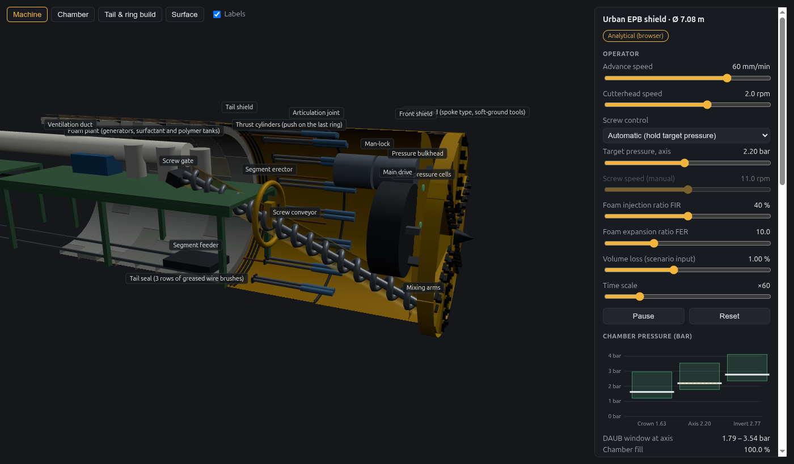

# Tunnel Construction Simulation

**An open, physics-based tunnel construction simulator for the browser, with cited models and GPU ground physics.**

[](https://dtt-github.github.io/tunnel-construction-simulation/)
[](https://github.com/dtt-github/tunnel-construction-simulation/actions/workflows/tests.yml)
[](LICENSE)


### ▶ [Open the live demo](https://dtt-github.github.io/tunnel-construction-simulation/)

It runs in the browser, with no install and no GPU needed.

| Demo | What it shows | Status |
|---|---|---|
| [Recorded GPU runs](https://dtt-github.github.io/tunnel-construction-simulation/phase0/replays/) | Soil simulated with the material-point method on an NVIDIA DGX Spark, then replayed: a tunnel face collapsing as its support retracts, and an EPB chamber stirred by a rotating cutterhead | Phase 0 benchmark. Tests speed and stability, not calibrated performance |
| [Hard-rock open gripper TBM](https://dtt-github.github.io/tunnel-construction-simulation/web/hard-rock/) | A 9.58 m main-beam TBM: disc cutterhead with buckets, grippers and regrip cycle, rock bolts, mesh and ring beams at L1 and shotcrete at L2 by rock class, fault zone, downtime per km | Slice B ([realism checklist](docs/realism/hard-rock-gripper.md)) |
| [Drill & blast road tunnel](https://dtt-github.github.io/tunnel-construction-simulation/web/drill-blast/) | A Norwegian T10.5 road tunnel round by round: the drilling pattern from published rules, a three-boom jumbo, charging, blast, ventilation, scaling, loader and trucks, bolts and sprayed concrete by support class, half-barrels, vibration at a house above | Slice E ([realism checklist](docs/realism/drill-blast-heading.md)) |
| [Urban slurry shield (Mixshield)](https://dtt-github.github.io/tunnel-construction-simulation/web/slurry/) | A 7.08 m Crossrail-class Mixshield in saturated sand and gravel: submerged wall and air cushion, feed and discharge lines with a crusher at the suction, filter cake or slurry penetration at the face, dry-mass balance and deposit velocity in the circuit | Slice C ([realism checklist](docs/realism/slurry-mixshield.md)) |
| [SEM / NATM heading](https://dtt-github.github.io/tunnel-construction-simulation/web/sem/) | A 10 m sprayed-concrete heading in weak rock: top heading, bench and invert by ground class, lattice girders, pipe canopies and ring closure in a fault zone, shotcrete stiffening with age, convergence monitoring with trigger levels | Slice D ([realism checklist](docs/realism/sem-heading.md)) |
| [Hard-rock double shield TBM](https://dtt-github.github.io/tunnel-construction-simulation/web/hard-rock/?machine=double) | A 9.9 m Follo-class double shield: telescopic shields, gripper shield, main and auxiliary thrust cylinders, segment rings built while boring with pea gravel and grout, single-shield mode in the fault zone | Slice B ([realism checklist](docs/realism/hard-rock-double-shield.md)) |
| [Urban EPB shield](https://dtt-github.github.io/tunnel-construction-simulation/web/epb/) | A 7 m EPB laid out front to back. Chamber pressure inside the DAUB window, automatic or manual screw control, foam conditioning, thrust and torque breakdown, the push and ring-build cycle with a universal 6 + key ring, and surface settlement over buildings | Slice A, with shift pattern, downtime and a 90-day advance forecast checked against record rates ([realism checklist](docs/realism/epb-slice-a.md)) |

[](https://dtt-github.github.io/tunnel-construction-simulation/web/epb/)

---

## Why this project

Tunnelling simulators today are either closed training products or research codes that take hours per run. This project aims for a tunnel you can trust numerically and still drive in real time:

- **Real machines.** TBMs penetrate, stall and wear cutters like real ones. EPB chambers hold pressure like real ones. Each method is laid out front to back after [sourced reference cards](docs/research/methods-reference.md).
- **Real ground.** Faces need the support pressure the ground demands, and surface settlement can be checked against monitoring data.
- **Every number cited.** Each model has a Python reference, a JavaScript twin, hand-checked tests, and published sources ([model catalogue](docs/MODELS.md)).
- **Honest labels.** Demos say what is recorded, illustrative or not yet calibrated ([realism rules](docs/ROADMAP.md#realism-rules-apply-to-every-phase)).

**Scope:**

- **TBM:** EPB, slurry/Mixshield, variable density, hard-rock open gripper, single and double shield.
- **Conventional:** NATM/SEM, drill & blast, roadheader.
- **Other:** cut-and-cover, pipe jacking, shafts.

## What works today

| Area | Status |
|---|---|
| **Model library** (Python + JavaScript, shared test vectors) | 7 models: CSM disc cutter, Hoek–Brown, settlement (troughs, longitudinal profile, method presets, twin tunnels, Burland), face support (wedge-silo + DAUB window), EPB chamber and screw, thrust and torque, utilisation and downtime with a record-rate check. [Details →](docs/MODELS.md) |
| **Machine class presets** | Six classes (urban EPB, Mixshield, double shield, main beam, SEM, drill & blast). Every field carries its source and a verified flag. [Presets →](models/presets/machine-classes.json) |
| **GPU physics (Phase 0)** | NVIDIA Newton implicit MPM on a DGX Spark: face stability and EPB chamber benchmarks, particle streaming, record and replay. [Results →](phase0/RESULTS.md) |
| **Browser client** | [Urban EPB shield](https://dtt-github.github.io/tunnel-construction-simulation/web/epb/) and [replay viewer](https://dtt-github.github.io/tunnel-construction-simulation/phase0/replays/) live, with the [hard-rock open gripper and double shield TBMs](https://dtt-github.github.io/tunnel-construction-simulation/web/hard-rock/) |

## Quick start

```bash
git clone https://github.com/dtt-github/tunnel-construction-simulation.git
cd tunnel-construction-simulation
npm run serve
```

Open http://127.0.0.1:8741/ and pick a demo (`web/` or `phase0/replays/`). There is no build step; any modern Chrome, Edge, Safari or Firefox works.

Run the tests:

```bash
npm test
```

```bash
npm run test:py
```

`npm test` checks the JavaScript models against the shared vectors (Node ≥ 22). `npm run test:py` runs the Python reference models with [uv](https://docs.astral.sh/uv/).

## Repository layout

| Folder | Contents |
|---|---|
| [`models/`](models) | Model library: [`py/`](models/py) reference implementations and tests, [`js/`](models/js) browser twins, [`test-vectors/`](models/test-vectors) shared expected values, [`presets/`](models/presets) machine class presets |
| [`web/`](web) | Browser client: plain ES modules, three.js and Jolt from a CDN, no build step |
| [`phase0/`](phase0) | GPU platform benchmarks, particle streaming, record and replay ([results](phase0/RESULTS.md)) |
| [`server/`](server) | Newton/Warp simulation server (Phase 2) |
| [`docs/`](docs) | Architecture, roadmap, model catalogue, realism checklists, research ([index](docs/README.md)) |
| [`knowledge/`](knowledge) | Local workspace for books and notes, never committed except its README |

## Documentation

| Document | What it covers |
|---|---|
| [Documentation index](docs/README.md) | Every document and where to start |
| [Architecture](docs/ARCHITECTURE.md) | The right physics at the right scale; the model library contract |
| [Roadmap](docs/ROADMAP.md) | Realism rules, phases and the method-by-method plan |
| [Model catalogue](docs/MODELS.md) | Every implemented model: equations, references, validation |
| [Methods reference](docs/research/methods-reference.md) | What each tunnelling method really looks like, with sources |
| [Research survey](docs/research/research-survey.md) | Literature, engines, standards and datasets |
| [Industry survey](docs/research/industry-survey.md) | Machine makers, published specifications, record advance rates |
| [Changelog](CHANGELOG.md) | What changed, release by release |

## Roadmap at a glance

1. **Phase 0, platform:** done. GPU benchmarks, streaming, record and replay.
2. **Phase R, realism reset:** done. Sourced method cards, corrected demo labels, cited presets.
3. **Phase 1, browser simulator:** one complete method at a time.
   - A: urban EPB (demo live, with downtime and record-rate check)
   - B: hard rock (open gripper and double shield live)
   - C: slurry / Mixshield (demo live)
   - D: SEM/NATM (heading live; final lining stage next)
   - E: drill & blast (demo live)
4. **Phase 2:** GPU ground physics coupled to the machine.
5. **Phase 3:** further methods.
6. **Phase 4:** validation against case histories.
7. **Phase 5:** training and research tools.

Full plan: [docs/ROADMAP.md](docs/ROADMAP.md).

## Contributing

We especially want **measured data**: TBM machine logs, settlement monitoring, face-pressure records, cutter wear. We also welcome models, 3D assets of real machinery and validation studies. See [CONTRIBUTING.md](CONTRIBUTING.md) and the [Code of Conduct](CODE_OF_CONDUCT.md).

## License

- **Code:** [Apache-2.0](LICENSE).
- **Third-party assets and data:** each keeps its own license, listed in [NOTICE](NOTICE).
- **Standards** (DAUB, ITA-AITES, EN, DIN): cited, never reproduced.

## Maintainers

Initiated and maintained by [DigitalTwin Technology GmbH](https://www.digitaltwin.technology) as part of [ConstructionWare](https://www.constructionware.app). Sister project: [construction-site-simulation](https://github.com/dtt-github/construction-site-simulation), which uses the same stack.
