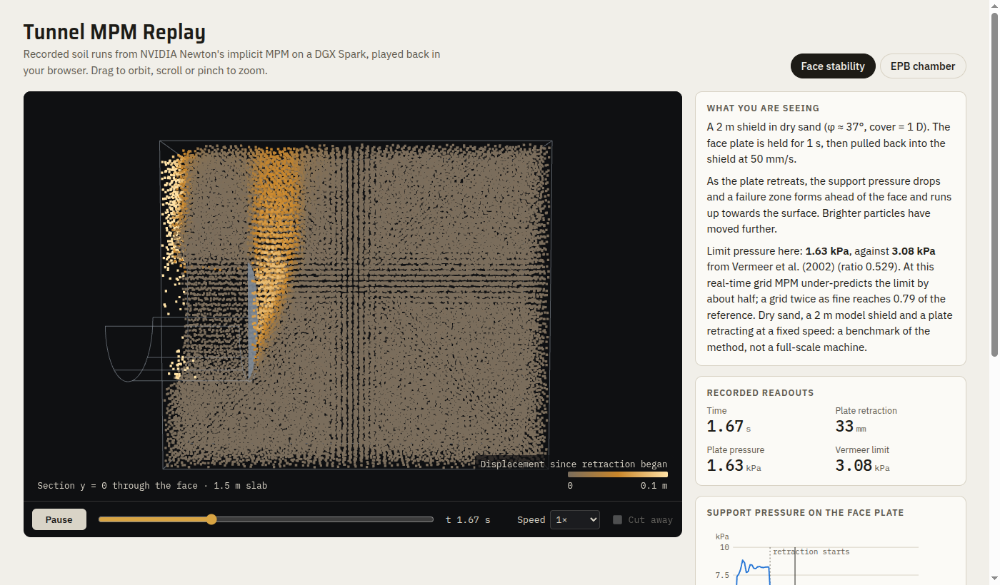

# Tunnel Construction Simulation

**An open, physics-based tunnel construction simulator for the browser, with cited models and GPU ground physics.**

[](https://dtt-github.github.io/tunnel-construction-simulation/)
[](https://github.com/dtt-github/tunnel-construction-simulation/actions/workflows/tests.yml)
[](LICENSE)


### ▶ [Open the live demo](https://dtt-github.github.io/tunnel-construction-simulation/)

It runs in the browser, with no install and no GPU needed.

| Demo | What it shows | Status |
|---|---|---|
| [Recorded GPU runs](https://dtt-github.github.io/tunnel-construction-simulation/phase0/replays/) | Soil simulated with the material-point method on an NVIDIA DGX Spark, then replayed: a tunnel face collapsing as its support retracts, and an EPB chamber stirred by a rotating cutterhead | Phase 0 benchmark. Tests speed and stability, not calibrated performance |
| [Hard-rock TBM prototype](https://dtt-github.github.io/tunnel-construction-simulation/web/) | Early prototype driven by the CSM disc-cutter model | **Being rebuilt** to match real machines ([why](docs/research/methods-reference.md#corrections-to-our-own-material)) |
| Urban EPB shield | Chamber pressure inside the DAUB window, screw control, foam conditioning, thrust and torque breakdown, ring build, surface settlement over buildings | In development ([Slice A](docs/ROADMAP.md#slice-a-urban-epb-7-m-class-first-most-models-already-exist)) |

[](https://dtt-github.github.io/tunnel-construction-simulation/phase0/replays/)

---

## Why this project

Tunnelling simulators today are either closed training products or research codes that take hours per run. This project aims for a tunnel you can trust numerically and still drive in real time:

- **Real machines.** TBMs penetrate, stall and wear cutters like real ones. EPB chambers hold pressure like real ones. Each method is laid out front to back after [sourced reference cards](docs/research/methods-reference.md).
- **Real ground.** Faces need the support pressure the ground demands, and surface settlement can be checked against monitoring data.
- **Every number cited.** Each model has a Python reference, a JavaScript twin, hand-checked tests, and published sources ([model catalogue](docs/MODELS.md)).
- **Honest labels.** Demos say what is recorded, illustrative or not yet calibrated ([realism rules](docs/ROADMAP.md#realism-rules-apply-to-every-phase)).

**Scope:**

- **TBM:** EPB, slurry/Mixshield, variable density, hard-rock open gripper, single and double shield.
- **Conventional:** NATM/SEM, drill & blast, roadheader.
- **Other:** cut-and-cover, pipe jacking, shafts.

## What works today

| Area | Status |
|---|---|
| **Model library** (Python + JavaScript, shared test vectors) | 7 models: CSM disc cutter, Hoek–Brown, settlement (troughs, longitudinal profile, method presets, twin tunnels, Burland), face support (wedge-silo + DAUB window), EPB chamber and screw, thrust and torque. [Details →](docs/MODELS.md) |
| **Machine class presets** | Six classes (urban EPB, Mixshield, double shield, main beam, SEM, drill & blast). Every field carries its source and a verified flag. [Presets →](models/presets/machine-classes.json) |
| **GPU physics (Phase 0)** | NVIDIA Newton implicit MPM on a DGX Spark: face stability and EPB chamber benchmarks, particle streaming, record and replay. [Results →](phase0/RESULTS.md) |
| **Browser client** | Replay viewer live. Urban EPB in development. Hard-rock machine being rebuilt |

## Quick start

```bash
git clone https://github.com/dtt-github/tunnel-construction-simulation.git
cd tunnel-construction-simulation
npm run serve
```

Open http://127.0.0.1:8741/ and pick a demo (`web/` or `phase0/replays/`). There is no build step; any modern Chrome, Edge, Safari or Firefox works.

Run the tests:

```bash
npm test
```

```bash
npm run test:py
```

`npm test` checks the JavaScript models against the shared vectors (Node ≥ 20). `npm run test:py` runs the Python reference models with [uv](https://docs.astral.sh/uv/).

## Repository layout

| Folder | Contents |
|---|---|
| [`models/`](models) | Model library: [`py/`](models/py) reference implementations and tests, [`js/`](models/js) browser twins, [`test-vectors/`](models/test-vectors) shared expected values, [`presets/`](models/presets) machine class presets |
| [`web/`](web) | Browser client: plain ES modules, three.js and Jolt from a CDN, no build step |
| [`phase0/`](phase0) | GPU platform benchmarks, particle streaming, record and replay ([results](phase0/RESULTS.md)) |
| [`server/`](server) | Newton/Warp simulation server (Phase 2) |
| [`docs/`](docs) | Architecture, roadmap, model catalogue, research ([index](docs/README.md)) |
| [`knowledge/`](knowledge) | Local workspace for books and notes, never committed except its README |

## Documentation

| Document | What it covers |
|---|---|
| [Documentation index](docs/README.md) | Every document and where to start |
| [Architecture](docs/ARCHITECTURE.md) | The right physics at the right scale; the model library contract |
| [Roadmap](docs/ROADMAP.md) | Realism rules, phases and the method-by-method plan |
| [Model catalogue](docs/MODELS.md) | Every implemented model: equations, references, validation |
| [Methods reference](docs/research/methods-reference.md) | What each tunnelling method really looks like, with sources |
| [Research survey](docs/research/research-survey.md) | Literature, engines, standards and datasets |
| [Industry survey](docs/research/industry-survey.md) | Machine makers, published specifications, record advance rates |
| [Changelog](CHANGELOG.md) | What changed, release by release |

## Roadmap at a glance

1. **Phase 0, platform:** done. GPU benchmarks, streaming, record and replay.
2. **Phase R, realism reset:** done. Sourced method cards, corrected demo labels, cited presets.
3. **Phase 1, browser simulator:** one complete method at a time.
   - A: urban EPB (in progress)
   - B: hard rock (open gripper, double shield)
   - C: slurry
   - D: SEM/NATM
   - E: drill & blast
4. **Phase 2:** GPU ground physics coupled to the machine.
5. **Phase 3:** further methods.
6. **Phase 4:** validation against case histories.
7. **Phase 5:** training and research tools.

Full plan: [docs/ROADMAP.md](docs/ROADMAP.md).

## Contributing

We especially want **measured data**: TBM machine logs, settlement monitoring, face-pressure records, cutter wear. We also welcome models, 3D assets of real machinery and validation studies. See [CONTRIBUTING.md](CONTRIBUTING.md) and the [Code of Conduct](CODE_OF_CONDUCT.md).

## License

- **Code:** [Apache-2.0](LICENSE).
- **Third-party assets and data:** each keeps its own license, listed in [NOTICE](NOTICE).
- **Standards** (DAUB, ITA-AITES, EN, DIN): cited, never reproduced.

## Maintainers

Initiated and maintained by [DigitalTwin Technology GmbH](https://www.digitaltwin.technology) as part of [ConstructionWare](https://www.constructionware.app). Sister project: [construction-site-simulation](https://github.com/dtt-github/construction-site-simulation), which uses the same stack.
